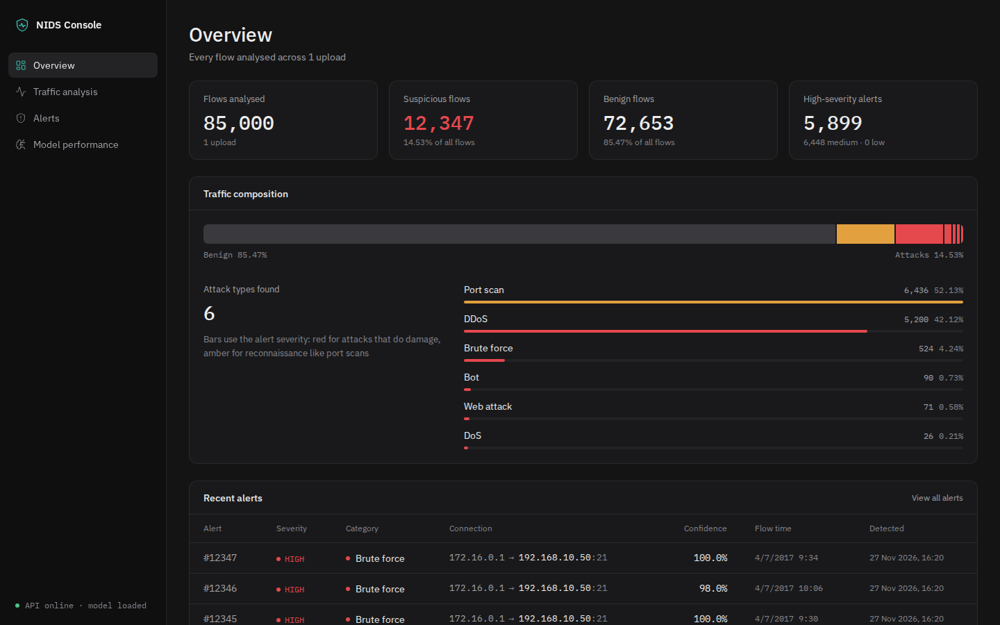
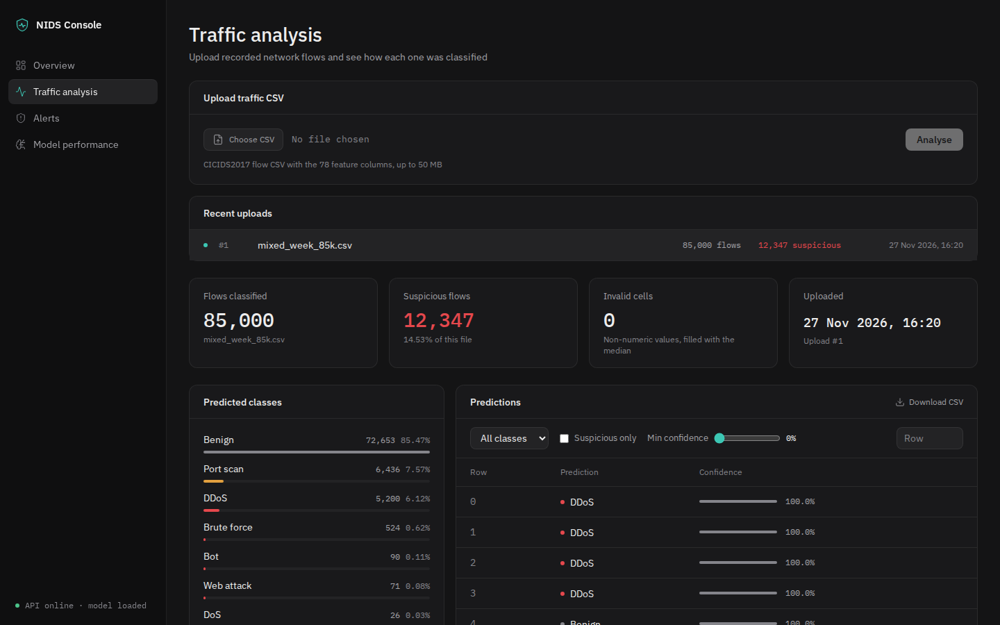
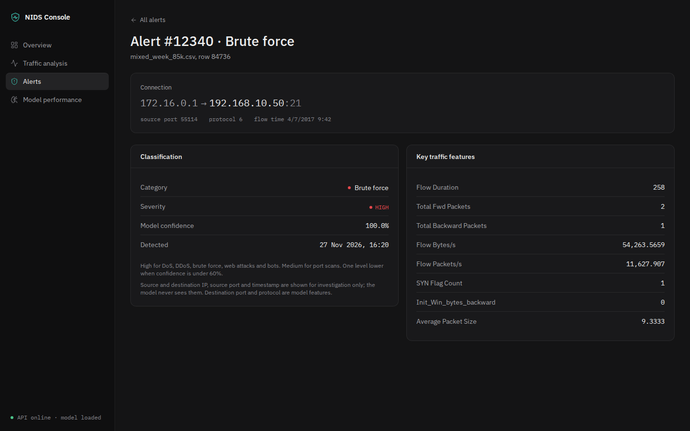
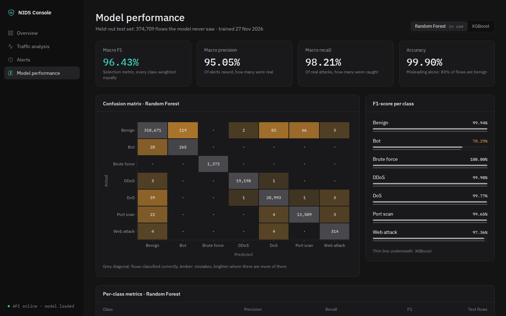

# AI-Based Network Intrusion Detection System

A machine learning system that reads recorded network traffic (one row per network flow), labels each flow as
**benign** or as a specific **attack type**, and shows the results on a web dashboard where you can investigate alerts
and check how accurate the model really is.

It is a **defensive** project. It analyses CSV files of recorded flows from a public dataset. It does not capture or
inspect live network traffic.



| Traffic analysis | Alert detail | Model performance |
| --- | --- | --- |
|  |  |  |

## Results

Trained on the full CICIDS2017 dataset. All numbers are from a held-out **test set of 374,709 flows** that the model
never saw during training or model selection. They are written by `ml/train.py` to `ml/artifacts/metrics.json`, and
`python -m ml.evaluate` re-computes them from the saved model.

| Model | Accuracy | Macro precision | Macro recall | Macro F1 |
| --- | --- | --- | --- | --- |
| **Random Forest (selected)** | 99.90% | 95.05% | 98.21% | **96.43%** |
| XGBoost | 99.91% | 93.99% | 99.79% | 96.29% |

Per class, Random Forest (test set):

| Class | Precision | Recall | F1 | Test flows |
| --- | --- | --- | --- | --- |
| Benign | 99.97% | 99.91% | 99.94% | 310,944 |
| DoS | 99.68% | 99.85% | 99.77% | 29,037 |
| DDoS | 99.98% | 99.98% | 99.98% | 19,202 |
| Port scan | 99.51% | 99.79% | 99.65% | 13,538 |
| Brute force | 100.00% | 100.00% | 100.00% | 1,373 |
| Web attack | 97.21% | 97.52% | 97.36% | 322 |
| Bot | 69.01% | 90.44% | 78.29% | 293 |

How to read this:

- **Accuracy is misleading here.** 83% of flows are benign, so a model that always answered "benign" would already
  score about 83%. The model is chosen by **macro F1** on the validation set, which weights every class equally.
- **Bot is the weak class.** About 30% of Bot alerts are really benign traffic, because there are only 1,953 Bot flows
  to learn from.
- **These scores are likely optimistic for real networks.** CICIDS2017 was recorded in one lab over five days, and a
  random split puts flows from the same attack sessions in both training and test data. Published research on this
  dataset reports the same effect.

## How it works

```
React dashboard (Vite, Tailwind, Plotly)
      │  JSON over HTTP, /api/v1/...
FastAPI routes          validation (Pydantic), rate limiting, safe errors
      │
Service layer           uploads, predictions, alerts, statistics
      │            │
ML pipeline        PostgreSQL (SQLAlchemy)
(loaded once at startup from ml/artifacts/model.joblib)
```

Training happens offline in `ml/train.py`. The backend only loads the saved pipeline and never trains.

### Machine learning pipeline

1. **Load and clean** (`ml/preprocessing.py`):
   - strip the spaces CICIDS2017 puts in column names and drop its duplicated column;
   - turn `Infinity` values into missing values;
   - fix the broken dash character in the web attack labels.
2. **Drop identifier columns:** Flow ID, source and destination IP, source port and timestamp. In this dataset the
   attacks come from a few known machines at known times, so these columns would let the model memorise "this IP at
   this time = attack" instead of learning what attack traffic looks like.
3. **Group the 15 raw labels into 7 classes:** Benign, DoS, DDoS, Port scan, Brute force, Web attack, Bot.
   Heartbleed (11 flows) and Infiltration (36 flows) are dropped: too few to learn from or test honestly.
4. **Remove duplicates before splitting,** so the same flow can never be in both the training and test sets. Flows with
   identical features but different labels are removed too.
5. **Split 70% train / 15% validation / 15% test**, stratified so every class keeps its share in each split.
6. **Handle class imbalance in the training split only:**
   - Benign is capped at 400,000 rows;
   - Random Forest uses `class_weight="balanced_subsample"`;
   - XGBoost uses balanced sample weights.
7. **Preprocessing lives inside one scikit-learn `Pipeline`** (clean → median imputation → model). It is fitted on the
   training data only, so the validation and test data never influence it.
8. **Model selection:** train Random Forest and XGBoost and keep the one with the best validation macro F1. The test
   set is used once, at the end, only to report numbers.
9. **Save** `model.joblib` (pipeline, class names, feature list) and `metrics.json` (all metrics, cleaning statistics,
   split sizes, library versions).

### Alerts and severity

Every flow predicted as an attack becomes an alert:

| Severity | Attack types |
| --- | --- |
| HIGH | DoS, DDoS, Brute force, Web attack, Bot |
| MEDIUM | Port scan (reconnaissance) |

An alert drops one level when the model's confidence is below 60%. If the uploaded CSV has source/destination IPs and
a timestamp, they are stored with the alert for investigation. The model never sees them.

## Project structure

```
network-intrusion-detection/
├── ml/
│   ├── preprocessing.py     cleaning, label mapping, the sklearn pipeline (shared with the backend)
│   ├── train.py             trains both models, picks the best, saves model + metrics
│   ├── evaluate.py          metrics function, and a CLI that re-checks the saved model on the test split
│   ├── data/raw/            CICIDS2017 CSVs go here (not in git)
│   └── artifacts/           model.joblib, metrics.json (test_split.pkl.gz is not in git)
├── backend/app/
│   ├── main.py              app startup: loads model and database, CORS, rate limiting, error handling
│   ├── config.py            settings from environment variables / .env
│   ├── api/routes.py        HTTP endpoints
│   ├── services/traffic.py  upload validation, prediction, alerts, statistics
│   ├── ml/predictor.py      loads the saved pipeline and predicts
│   ├── models/db_models.py  database tables
│   ├── schemas/schemas.py   Pydantic request/response models
│   ├── database/session.py  SQLAlchemy engine and sessions
│   └── utils/rate_limit.py  per-IP rate limiting
├── frontend/src/
│   ├── pages/               Overview, Traffic analysis, Alerts (+ detail), Model performance
│   ├── components.jsx       shared layout, cards, tables, charts
│   └── api.js               fetch wrapper with readable errors
├── tests/                   pytest suite (ML, API, database) + a 44-row real-data fixture
├── scripts/create_db.sh     one-time PostgreSQL user and database setup
├── docs/screenshots/        images used in this README
├── requirements.txt         Python dependencies for both ML and backend
├── .env.example             configuration template
└── pytest.ini
```

Two changes from a typical layout, on purpose:

- **One `requirements.txt` at the root.** The saved model only loads with the same pandas, scikit-learn and XGBoost
  versions it was trained with, so training and the backend share one pinned file.
- **One `tests/` folder at the root.** ML and backend tests run with a single `pytest` command.

## Setup

Tested on Linux with Python 3.14, Node.js 22 and PostgreSQL 18. Python 3.12 or newer and PostgreSQL 16 or newer should
also work.

### 1. Python environment

Run all commands from the `network-intrusion-detection/` folder.

```bash
python3 -m venv .venv
```

```bash
.venv/bin/pip install -r requirements.txt
```

### 2. Configuration

```bash
cp .env.example .env
```

Edit `.env` and replace both `CHANGE_ME` values with one strong password of your choice, for example from
`python3 -c "import secrets; print(secrets.token_hex(16))"`. `.env` is git-ignored. Never commit it.

| Variable | Purpose | Default |
| --- | --- | --- |
| `DATABASE_URL` | PostgreSQL connection for the app | required |
| `TEST_DATABASE_URL` | PostgreSQL database for tests (wiped on every test run) | optional |
| `MAX_UPLOAD_MB` | Largest CSV accepted by `/upload` | 50 |
| `RATE_LIMIT_PER_MINUTE` | Requests per minute per IP | 120 |
| `CORS_ORIGINS` | Comma-separated browser origins allowed to call the API | `http://localhost:5173` |

### 3. PostgreSQL

Creates the `nids` user (with the password from `.env`) and the `nids` and `nids_test` databases. It asks for your sudo
password and is safe to run again.

```bash
bash scripts/create_db.sh
```

The databases use PostgreSQL's built-in `C.UTF-8` locale, which avoids "collation version mismatch" errors on systems
where the OS was upgraded after PostgreSQL was installed. Tables are created automatically when the backend starts.

### 4. Dataset (CICIDS2017)

The dataset is not downloaded automatically.

1. Go to the official page, https://www.unb.ca/cic/datasets/ids-2017.html, and follow the download link. The Canadian
   Institute for Cybersecurity asks you to fill in a short form first.
2. Open `CSVs/` and download **`GeneratedLabelledFlows.zip`** (about 270 MB, 1.2 GB unzipped). Check it against the
   `.md5` file next to it.
3. Unzip the 8 CSV files into `ml/data/raw/`:

```bash
unzip -j ~/Downloads/GeneratedLabelledFlows.zip '*.csv' -d ml/data/raw
```

`MachineLearningCSV.zip` from the same page also works for training. It lacks the `Protocol` column, though, so a model
trained on it expects 77 features instead of 78, and the dashboard cannot show IP addresses on its alerts.

### 5. Train

Check the whole pipeline on 5% of the data first (under a minute):

```bash
.venv/bin/python -m ml.train --sample-frac 0.05
```

Then train on the full dataset (about 4 minutes and 4.3 GB of RAM on a 16-core machine):

```bash
.venv/bin/python -m ml.train
```

Re-check the saved model against the saved test split:

```bash
.venv/bin/python -m ml.evaluate
```

A trained model is already included in `ml/artifacts/`, so this step is only needed to retrain.

### 6. Run

Backend (API docs at http://localhost:8000/docs):

```bash
.venv/bin/uvicorn backend.app.main:app --reload --port 8000
```

Frontend, in a second terminal (dashboard at http://localhost:5173):

```bash
cd frontend && npm install && npm run dev
```

The Vite dev server forwards `/api` and `/health` to the backend, so the frontend contains no backend address or
secret.

### 7. Try it

The original CICIDS2017 files are bigger than the 50 MB upload limit. To make a smaller test file, for example
20,000 random flows from the Friday port-scan capture:

```bash
.venv/bin/python -c "import pandas as pd; pd.read_csv('ml/data/raw/Friday-WorkingHours-Afternoon-PortScan.pcap_ISCX.csv', encoding='latin-1', low_memory=False).sample(20000, random_state=1).to_csv('portscan_sample.csv', index=False, encoding='latin-1')"
```

Upload `portscan_sample.csv` on the **Traffic analysis** page, or use the 44-row file `tests/fixtures/sample_flows.csv`
for a quick check. These rows come from the training dataset, so they show the app working, not its accuracy.

## Tests

```bash
.venv/bin/pytest
```

61 tests cover:

- **Data preprocessing:** column cleaning, label mapping, duplicate and conflict removal, `Infinity` handling, and an
  end-to-end training run on a tiny synthetic CSV.
- **Model inference:** single and batch predictions with the real trained model, probabilities, and `/model/info`.
- **API endpoints:** upload → results → CSV download → alerts → dashboard stats, filters, 404s and rate limiting.
- **Invalid uploads:** wrong extension, empty, binary, unparseable, missing columns, duplicate columns, over the size
  limit, path-traversal filenames, and non-numeric cells.
- **Database operations:** model registration, persisting uploads, `NaN`/`Infinity` stored as null, and nothing written
  when an upload is rejected.

Every API and database test runs on in-memory SQLite and, when `TEST_DATABASE_URL` is set, again on PostgreSQL.

## API

Interactive documentation: http://localhost:8000/docs

| Method | Path | Purpose |
| --- | --- | --- |
| GET | `/health` | Backend, model and database status |
| GET | `/api/v1/model/info` | Selected model, classes, feature list, all real metrics |
| POST | `/api/v1/predict` | Classify one flow: `{"features": {"Flow Duration": 1200, ...}}` |
| POST | `/api/v1/predict/batch` | Classify up to 1,000 flows: `{"records": [{"features": {...}}, ...]}` |
| POST | `/api/v1/upload` | Upload a CSV (multipart field `file`); validates, classifies and stores it |
| GET | `/api/v1/uploads` | Recent uploads |
| GET | `/api/v1/uploads/{id}` | One upload's summary |
| GET | `/api/v1/uploads/{id}/results` | Paginated predictions; filters `label`, `malicious_only`, `min_confidence`, `row_index` |
| GET | `/api/v1/uploads/{id}/results.csv` | All predictions of an upload as CSV |
| GET | `/api/v1/alerts` | Paginated alerts; filters `severity`, `category`, `upload_id` |
| GET | `/api/v1/alerts/{id}` | Alert detail with key traffic features |
| GET | `/api/v1/dashboard/stats` | Totals, class distribution, severity counts, recent alerts |

`/predict` and `/predict/batch` need all 78 feature columns listed by `/model/info`; `null` values are allowed and
filled with the training median. Predictions sent this way are not stored. Only uploads are saved.

## Database

| Table | What it stores |
| --- | --- |
| `model_metadata` | Each loaded model: name, training time, test macro F1, full metrics, active flag |
| `uploads` | File name, size, row count, suspicious count, invalid cells, per-class counts |
| `predictions` | Per uploaded row: row number, predicted label, confidence |
| `alerts` | Per suspicious row: category, severity, confidence, flow time, ~14 key fields for investigation |

The 78 raw features of each flow are **not** stored. An 85,000-row (45 MB) upload takes about 23 MB of database space.

## Security

- **File checks:** uploads must be `.csv`, at most `MAX_UPLOAD_MB`, not empty or binary, parseable, without duplicate
  columns, and contain every required column. Anything else gets a clear 400 or 413 error.
- **Uploads are never executed or written to disk.** They are parsed in memory by pandas, which only reads values. The
  uploaded filename is cut to its base name and used for display only.
- **Database queries** all go through SQLAlchemy, so values are always parameterised.
- **Secrets** live in `.env` only. The frontend contains none.
- **Rate limiting** is per IP (`/health` is exempt).
- **Errors:** unexpected errors return a plain "Internal server error". Details go to the server log only.
- **`model.joblib` is a pickle.** `MODEL_PATH` must only ever point at your own training output, never at a
  user-supplied file.

## Known limitations

- **Recorded flows only:** the system analyses CSV files of flows produced by CICFlowMeter. It does not capture live
  traffic.
- **Known attacks only:** it recognises the attack types in CICIDS2017. New kinds of attacks would most likely be
  labelled benign or as the closest known type.
- **Optimistic scores:** the reported scores come from one lab dataset with a random split, so performance on a
  different network would likely be lower.
- **Rate limiting** is in-memory: per process, reset on restart.
- **Database migrations:** tables are created with `create_all`. Schema changes would need a migration tool such as
  Alembic.
- **Bundle size:** the frontend JavaScript bundle is about 5 MB because of Plotly.

## Updating the screenshots

With the backend and frontend running and some data uploaded, open each page at a 1440 × 900 window and save a
screenshot into `docs/screenshots/` with the same file names (`overview.png`, `traffic.png`, `alerts.png`,
`alert_detail.png`, `model.png`).

## Dataset credit

Iman Sharafaldin, Arash Habibi Lashkari and Ali A. Ghorbani, "Toward Generating a New Intrusion Detection Dataset and
Intrusion Traffic Characterization", ICISSP 2018. Canadian Institute for Cybersecurity, University of New Brunswick.
